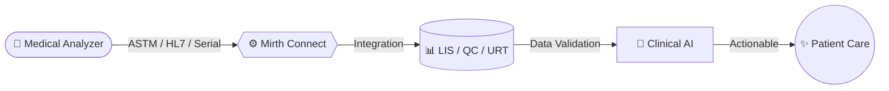
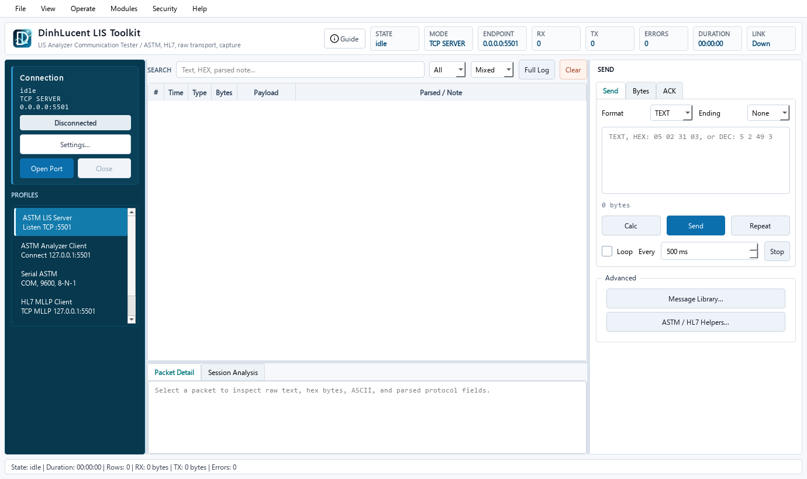

<div align="center">
  
</div>

<div align="center">
  <h3>ENG.DINH</h3>
  <p><i>Building the bridge between medical devices, clinical data, and intelligent systems.</i></p>
  <p><b>Healthcare Integration Engineer</b> specializing in LIS, medical analyzer connectivity, Mirth Connect, HL7/ASTM protocols, and Bio-Rad QC/URT workflows.</p>
</div>

<div align="center">
  <a href="https://git.io/typing-svg"></a>
</div>

<div align="center">
  <a href="https://www.linkedin.com/in/sang-dinh-a31856160/"></a>
  <a href="https://github.com/DinhLucent"></a>
  <a href="https://www.facebook.com/hoangsang2020/"></a>
</div>

---

## 🧬 From Device to Care

> *"Bridging the gap between raw machine signals and clinical decisions."*



---

## 🌟 Open Source Contributions

- **[healthchainai/HealthChain](https://github.com/healthchainai/HealthChain)** — Open-source Healthcare AI & Interoperability Framework
  - **Merged [PR #204](https://github.com/healthchainai/HealthChain/pull/204)**: `fix(interop): use bundled configs when config_dir is omitted` — Resolved configuration fallback for production interoperability channels.
  - **Active [PR #194](https://github.com/healthchainai/HealthChain/pull/194)**: `feat: add ClinicalImpression helper and Observation classification` — Expanding clinical observation structures and FHIR data helpers.

---

## 🔌 Device Connectivity & Laboratory Systems

| Domain | Analyzers & Clinical Hardware |
| --- | --- |
| **Chemistry** | Furuno CA270, CA400, CA800; EXIAS e\|1; Elitech clinical chemistry series |
| **Hematology** | Nihon Kohden MEK9100, MEK7300, MEK13xx (certified interfacing) |
| **Urinalysis** | Analyticon Urilyzer 100 Pro, 500 Pro, Urilyzer Auto |
| **Renal Care** | Baxter Prismaflex, PrisMax (continuous renal replacement therapy) |
| **Quality Control** | Bio-Rad Unity / QC / URT clinical management system integration |
| **Multi-vendor** | Bidirectional analyzer connectivity via RS-232 serial, TCP/IP, and HL7/ASTM protocols |

---

## 🏗️ Core Engineering Showcases

### 🔬 [HyperScribe LIS Toolkit](https://github.com/DinhLucent/lis-toolkit-releases) `v0.4.7`

Enterprise desktop suite for verifying laboratory information system (LIS) connectivity, inspecting bidirectional ASTM E1381/E1394 and HL7 v2.x analyzer frames, and simulating clinical chemistry and hematology instruments.

- **Security & Licensing**: Asymmetric Ed25519 cryptographic signatures bound to Windows DPAPI hardware fingerprints.
- **Self-Service Web Portal**: Automated cloud license provisioning at [lis-license-portal.vercel.app](https://lis-license-portal.vercel.app).
- **Verified Package**: [Download Official Release (Windows x64)](https://github.com/DinhLucent/lis-toolkit-releases).

<div align="center">
  <a href="https://github.com/DinhLucent/lis-toolkit-releases">
    
  </a>
</div>

<br/>

- **[Simulation-LIS-Analyzer-CA270](https://github.com/DinhLucent/Simulation-LIS-Analyzer-CA270)** — ASTM E1381/E1394 bidirectional LIS simulator and test harness for Furuno CA270 analyzers. Eliminates physical hardware dependency during laboratory software integration.
- **[hl7-message-parser](https://github.com/DinhLucent/hl7-message-parser)** — Zero-dependency HL7 v2.x parser and fluent builder in Python. Handles MSH, PID, and OBX segment trees with clinical syntax validation.
- **[fhir-patient-dashboard](https://github.com/DinhLucent/fhir-patient-dashboard)** — Web interface visualizing FHIR R4 Patient demographics, diagnostic observations, and vital trends.
- **[geminiweb2api](https://github.com/DinhLucent/geminiweb2api)** — High-concurrency Go proxy service built with Uber-Fx dependency injection, Fiber v3, and automated Docker release workflows.

---

## 🧑‍💻 About Me

```yaml
name: "ĐINH HOÀNG SÁNG (ENG.DINH)"
role: "Healthcare Integration Engineer"
focus: "LIS • Medical Device Connectivity • Mirth Connect • HL7/ASTM • QC/URT • Agentic AI"
mission: "Building the bridge between medical devices, clinical data, and intelligent systems"
location: "Ho Chi Minh City, Vietnam 🇻🇳"
education: "B.Eng Biomedical Engineering — International University (VNU-HCM)"
experience: "3+ years"

what_i_do:
  - "LIS software development & lab analyzer connectivity"
  - "Mirth Connect integration — HL7/ASTM/FHIR channels"
  - "Medical device interfacing (analyzers, POCT, serial RS-232, TCP/IP)"
  - "Connecting multi-vendor laboratory analyzers into Bio-Rad QC/URT systems"
  - "Clinical tools & healthcare data validation"
  - "Applied agentic AI for healthcare integration workflows"
```

---

## 🚀 Professional Journey

<div align="left">

- **2017 — 2021 | 🎓 Biomedical Engineering Foundation**  
  Graduated with **B.Eng in Biomedical Engineering** from International University (VNU-HCM). Focused on medical instrumentation, biosignal processing, and clinical informatics.

- **2021 — 2021 | 💡 Clinical AI Research Internship**  
  Built deep learning and computer vision pipelines for medical image analysis and diagnostic support.

- **2021 — 2022 | 🤖 AI Engineer**  
  Developed computer vision systems for clinical research, connecting medical imaging data with automated detection pipelines.

- **2022 — Present | 🏥 Healthcare IT & Systems Integration Engineer**  
  Driving medical device integration across hospitals and laboratories. Connecting automated analyzers to LIS, QC, and URT systems via **HL7/ASTM**, serial/TCP interfaces, and Mirth Connect channels.

</div>

---

## ⚡ Tech Stack

> **Healthcare Integration Architecture**
> 
> - **Devices:** `Analyticon Urilyzer` • `Furuno CA270/400/800` • `EXIAS e|1` • `Nihon Kohden MEK` • `Elitech` • `Baxter Prismaflex/PrisMax` • `Bio-Rad`
> - **Protocols:** `ASTM E1381/E1394` • `HL7 v2.x` • `FHIR R4` • `TCP/IP` • `RS-232 Serial`
> - **Middleware & Backends:** `Mirth Connect` • `Python` • `Go` • `FastAPI` • `SQL Server` • `PostgreSQL`
> - **Intelligence & Quality:** `Agentic AI` • `Data Validation` • `Bio-Rad QC/URT` • `Lab Automation`

<br/>

<details>
<summary><b>🛠️ Full Tech Stack & Tools (Click to expand)</b></summary>
<br/>

<div align="center">

**Protocols & Standards:**<br/>


**Languages:**<br/>


**Backend & Data:**<br/>


**DevOps & Engineering Tools:**<br/>


</div>
</details>

---

<details>
<summary><b>📜 Verified Certifications & Credentials</b></summary>
<br/>

**2026**

| #   | Course                                                               | Credential                                                                                                                         |
| --- | -------------------------------------------------------------------- | ---------------------------------------------------------------------------------------------------------------------------------- |
| 1   | AI Agents and Agentic AI with Python & Generative AI                 | [](https://coursera.org/share/b4f00b18685718882a24afb4c4e9325e) |

**2022**

| #   | Course                                                      | Credential                                                                                                                                       |
| --- | ----------------------------------------------------------- | ------------------------------------------------------------------------------------------------------------------------------------------------ |
| 1   | Python Project for Data Engineering                         | [](https://www.coursera.org/account/accomplishments/certificate/VA42PVC5YYX4) |
| 2   | Introduction to Data Engineering                            | [](https://www.coursera.org/account/accomplishments/certificate/GGJK87NA7UF3) |
| 3   | Introduction to Docker : The Basics                         | [](https://www.coursera.org/account/accomplishments/certificate/B9KZ6PAKMFF7) |
| 4   | AI for Medical Prognosis                                    | [](https://www.coursera.org/account/accomplishments/certificate/NKCSECA9929H) |
| 5   | Python Data Structures                                      | [](https://www.coursera.org/account/accomplishments/certificate/DFDNJD3F8UDJ) |
| 6   | Programming for Everybody (Getting Started with Python)     | [](https://www.coursera.org/account/accomplishments/certificate/MCQNC2PJB3TB) |
| 7   | Linux and Bash for Data Engineering                         | [](https://www.coursera.org/account/accomplishments/certificate/XT4XVKF79JMQ) |
| 8   | Python for Data Science, AI & Development                   | [](https://www.coursera.org/account/accomplishments/certificate/WBJSFA4KRTKB) |
| 9   | Build a Data Science Web App with Streamlit and Python      | [](https://www.coursera.org/account/accomplishments/certificate/LTMZ5SV5J36Q) |
| 10  | Hyperparameter Tuning with Keras Tuner                      | [](https://www.coursera.org/account/accomplishments/certificate/FEVUFPUQJS3H) |
| 11  | Deep Learning with PyTorch : Object Localization            | [](https://www.coursera.org/account/accomplishments/certificate/GLQMSMFNY2SL) |
| 12  | Deep Learning with PyTorch : Generative Adversarial Network | [](https://www.coursera.org/account/accomplishments/certificate/YHVDC6XBFE9A) |
| 13  | Data Visualization using Plotly                             | [](https://www.coursera.org/account/accomplishments/certificate/NWK2AERGVDTJ) |
| 14  | Deep Learning with PyTorch : Image Segmentation             | [](https://www.coursera.org/account/accomplishments/certificate/Z6PPVGV6NNHT) |

**2020**

| #   | Course                                                                                 | Credential                                                                                                                         |
| --- | -------------------------------------------------------------------------------------- | ---------------------------------------------------------------------------------------------------------------------------------- |
| 1   | Improving Deep Neural Networks: Hyperparameter Tuning, Regularization and Optimization | [](https://coursera.org/share/7f5c7c8b598ba2f7e90c54726b5a995a) |
| 2   | Neural Networks and Deep Learning                                                      | [](https://coursera.org/share/b3a3815dfe1fca3744e6b86261c1d8b1) |
| 3   | Convolutional Neural Networks                                                          | [](https://coursera.org/share/0c3d7a83201d18698df6563471970781) |

</details>

---

## 📈 GitHub Stats

<div align="center">
  
  
</div>

---

<div align="center">
  
</div>

<div align="center">
  <sub><i>"Ruthless Pragmatism — build what works, ship what matters."</i></sub>
</div>

---
Built by [DinhLucent](https://github.com/DinhLucent)
